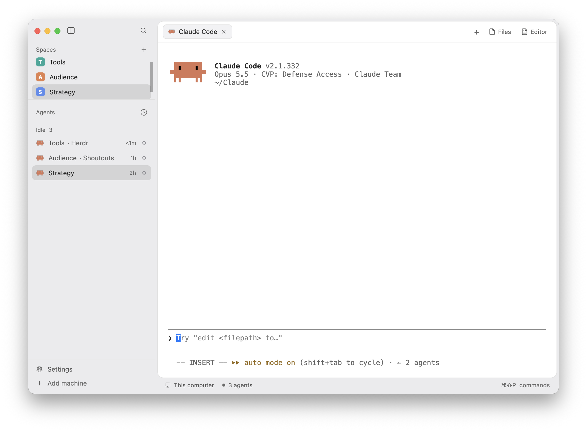
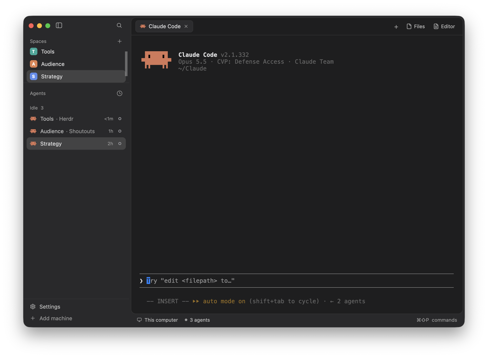

# macOS theme for Herdr

A native-feeling macOS look for the [Herdr](https://herdr.dev) desktop app, the terminal app
for coding agents. It ports [sable-theme-macos](https://github.com/CR0CKER/sable-theme-macos), a
theme for the Sable Matrix client that follows the Slack-for-Mac layout:

- **One grey window.** Window and sidebar share Apple's window grey (`#ebebed` light, `#29292b` dark).
- **An inset content card.** The tab bar and terminals sit on a white (dark: `#1e1e1f`) card,
  4 px from the window edge, with 12 px corners and a hairline edge (no drop shadow: Herdr's
  layout shadow draws a flat grey band rather than a soft blur).
- **Apple system colours.** System blue accent; the terminal palette is built from Apple's hues,
  each adjusted only as far as needed for 4.5:1 contrast.
- **System fonts.** SF Pro for the interface (with real bold) and Menlo for terminals.
- **Light and dark**, following the system appearance.

It's one layout, **macOS**, with a light and a dark theme (`macos-light`, `macos-dark`).




## The sidebar

- **Folding:** one button sits just right of the window buttons, as in Finder, Mail and Notes,
  and it stays in that spot when the sidebar folds. **Cmd+B** does the same. **Cmd+Shift+B**
  hides the sidebar completely. No app title or icon in the header: just the window buttons,
  the sidebar button and search.
- **Motion:** the sidebar slides open and closed (180 ms). Its content moves out with the edge
  rather than squeezing, and the folded rail fades in as the edge settles.
- **Folded rail:** each space shows its coloured letter badge, with that space's agents under it.
  A line in the space's colour joins them.
  - The selected space has a grey ring around its badge.
  - The active agent is marked by a thicker stretch of the line, which slides to the new agent
    when focus moves.
  - "Needs you" pulses gently.
  - Resting the pointer on a badge or icon shows a card: name, folder, shortcut (⌃1–9),
    agents and status.

## Files panel

- The **Files** and **Changes** buttons in the tab bar slide the side panel open and shut. The file
  list keeps its width and rides the edge rather than squeezing.
- **Sort** from the panel's header: click **Name** to move on to **Modified** and **Created** (newest
  first, folders and files together, each row showing its date), and back.
- The **eye** button next to it hides or shows dot files (`.git`, `.claude`, …).
- Both choices are remembered.

## Reordering tabs

Drag a tab sideways in the tab bar. A copy follows the pointer and a thin blue line shows where it
will land: on the left half of a tab it goes before it, on the right half after it.

## Moving agents between spaces

Drag an agent onto another space in the sidebar to move it there. It keeps running, and its tab
keeps its name. You can drag:

- a **tab** out of the tab bar (dragging within the bar still reorders tabs);
- a **row** in the Agents list;
- an **agent icon** on the folded rail.

While you drag, a copy of the tab follows the pointer, the space under it is outlined in blue, and a **New space** row appears at
the end of the list: drop there to give the agent a space of its own (named after its folder).
Moves stay on one machine. A tab split into several panes arrives with its panes side by side.

## Extra tab bar buttons

Other mods can add buttons to the tab bar, next to Files. List them in your own
`~/.config/herdr-app/tab-buttons.json` (the installer never touches it, so reinstalling the
theme keeps your buttons):

```json
[{ "mod": "my-mod", "label": "Do it", "icon": "mods/my-mod/icon.svg", "tooltip": "What it does" }]
```

A click opens that mod as an invisible 1×1 window with the focused terminal in its props
(`terminal`, `pane`, `tab`, `space`, `cwd`); the mod does its job and closes itself with
`closeOverlay(props().overlay)`. A window doesn't take the keyboard, so focus stays where it was.
For a shortcut, bind `mod.open:my-mod` in keys.json; the mod then falls back to `focused()`.

## Notifications in Notification Center

Herdr shows its notifications ("needs you", "done", errors) inside the window. To get them in
macOS Notification Center instead, create `~/.config/herdr-app/notifications.json`:

```json
{ "system": true }
```

Every notification then goes to the system. Two ways to post, tried in this order:

- **terminal-notifier**: clicking a notification brings Herdr forward and goes to the agent. Set
  it up once with Herdr's name and icon:

  ```sh
  brew install terminal-notifier
  sh tools/herdr-notifications.sh   # builds ~/Applications/Herdr Notifications.app
  ```

  then allow **Herdr** in System Settings > Notifications. (Plain terminal-notifier works too,
  under its own name and icon. Run straight from Homebrew it may fail with "Notifications are
  not allowed for this application", because macOS never registered it as an app; the script
  does that.)
- **AppleScript** (built in), used while terminal-notifier is missing or not allowed: macOS shows
  the notification as Script Editor's, and clicking it opens Script Editor rather than the agent.

If neither gets through, the usual in-app toast shows, with a hint. On Linux the same setting uses
`notify-send`. Delete the file, or set `"system": false`, for the in-app toasts again.

## Install

Requires Herdr 0.1.18 or later (built and tested on herdr-app 0.1.18, herdr-core 0.1.22).

Ask your agent in Herdr to add the layout, as with any layout from
[herdr.dev/layouts](https://herdr.dev/layouts): it follows `RECIPE.md` and Herdr's own instructions
(copy `layouts/`, `mods/` and `themes/`, merge `keys.json`, check each mod, switch to the layout).

Or, from a clone of this repo (needs `python3`):

```sh
sh install.sh            # stops if a file would overwrite a different one
sh install.sh --switch   # also switch to the macOS layout
sh install.sh --force    # overwrite differing files and key bindings
```

It copies `themes/`, `layouts/` and `mods/` into `~/.config/herdr-app` (or `$HERDR_APP_HOME`),
merges `keys.json` into yours, and runs `herdr-app check` on each mod. Herdr picks the files up
while running. The keys (**Cmd+B** folds the sidebar, **Cmd+Shift+B** hides it) apply only while
the macOS layout is shown; other layouts keep Herdr's own.

Switch layouts with **Cmd+Shift+L**, or in Herdr's Settings (the layout has a preview picture).

**Uninstall:** delete `themes/macos-*.json`, `layouts/macos.{json,svg}` and the seven
`mods/*-md` folders from Herdr's config folder, and the `"layout:macos"` section from `keys.json`.

## Linux

The files are the same on Linux (tested only on macOS so far). The fonts fall back automatically:
`.SystemUIFont` becomes the desktop's sans font, and Menlo (missing) becomes JetBrains Mono. The
collapsed rail is 72 px wide instead of 108 px, because there are no macOS window buttons to
leave room for. The fold was tested on Asahi Linux (GNOME): slide, rail and header.

## Repository layout

What gets installed mirrors Herdr's config folder:

```
themes/           macos-light.json, macos-dark.json        (generated by tools/gen.py)
layouts/          macos.json, macos.svg preview            (generated by tools/mklayout.py)
mods/             tabs-md, status-md, spaces-md, agents-md, chrome-md, toast-md, files-md
keys.json         Cmd+B / Cmd+Shift+B for the macOS layout
RECIPE.md         the brief another agent can build the layout from
preview.png       light screenshot (herdr.dev/layouts shows it); preview-dark.png, dark
tools/            generators, base layout, screenshot helpers (macOS)
upstream/         Herdr's unmodified originals of the cloned mods (0.1.18), for diffing
reference/sable/  the Sable macOS theme CSS this was ported from
```

Every change inside a cloned mod is marked `// Added:` or `// Changed:`; diff a clone against its
original in `upstream/herdr-0.1.18/mods/` to see them all.

## License

Apache License 2.0 (`LICENSE`); see `NOTICE` for the parts that come from Herdr and others.
