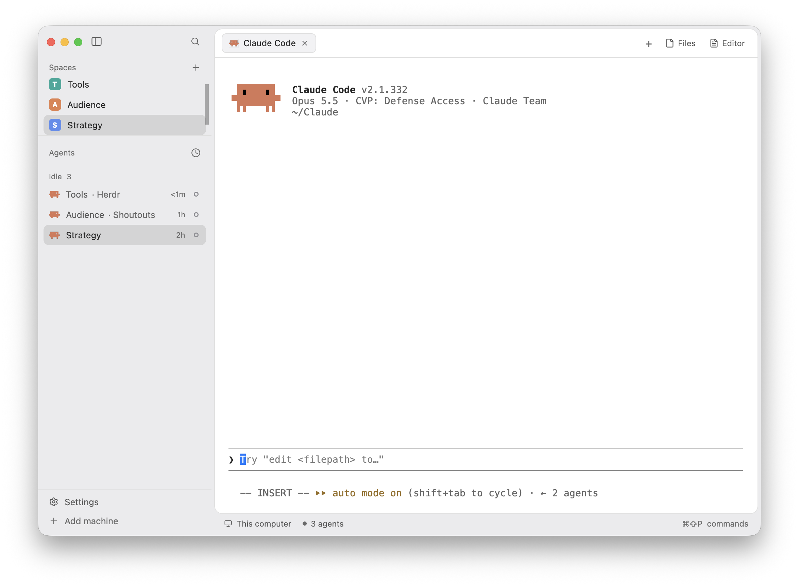

# macOS

Herdr as a native Mac app, laid out like Slack for Mac: one grey window (sidebar and window share
Apple's window grey), the tab bar and terminals on an inset white card with 12px corners and a
hairline edge, Apple's system blue, SF Pro for the interface and Menlo in the terminals, light and
dark following the system. The sidebar folds to a rail of large space badges with each space's
agents under them.

## What you see

- **Window:** no title bar; the macOS traffic lights sit in the sidebar's top row at (12, 16).
  Light: window `#ebebed`, card `#ffffff`, text `#262626`, accent `#007aff`. Dark: window
  `#29292b`, card `#1e1e1f`, text `#dfdfe0`, accent `#0a84ff`.
- **Sidebar (left, 268px, window grey, no divider to the window):**
  - Header row, 46px: the traffic lights, then the sidebar button (28px, 18px icon) 72px from the
    left; search (28px) at the row's end. No app title or icon.
  - "Spaces" (dim, 11.5px) with a +; rows 30px with an 18px coloured letter tile and the name;
    the selected row neutral grey (`#d4d4d5` light, `#434344` dark), never blue.
  - "Agents" below, Herdr's agents list.
  - Footer, 69px, a hairline on top: Settings, Add machine.
- **Folded rail (108px on macOS, 72px elsewhere):** the sidebar button stays where it was; each
  space is a 44px letter badge (11px corners) in a 60px cell, the selected one with a 2px grey
  ring (`idle`) 3px out; a 14px status dot on the badge's corner when it needs you (pulsing) or is
  done. Under the badge, the space's agents as 28px program icons in 40px cells, in a column as
  wide as the badge whose left edge is a 2px line in the space's colour; the active agent is a 4px
  bar on that line. Each icon's status sits on its corner (spinner, pulsing "!", ring, dot).
  10px above each badge, 14px below its agents. Footer: Settings and Add machine as icons.
- **Card (right, 4px from the window edge, radius 12, 1px border):**
  - Tab bar, 42px, no fill of its own (the card's corners show): tabs with program icon, title,
    status; + and the Files / Changes buttons at the end.
  - Terminals 6px inside the card. A single pane has no frame; split panes get an 8px-radius
    hairline frame and a 1px accent focus ring.
- **Status bar** below the card, 28px, on the window grey with no fill or top line, like Finder's
  path bar.
- **Terminal colours:** Apple's hues, each lightness moved only as far as needed for 4.5:1 on the
  card (bright black too, since Claude Code uses it for secondary text).

## How it behaves

- **Agent status:** working = blue spinner (`#0066d6` light, `#4aa3ff` dark), blocked ("needs
  you") = orange (`#9c5b00`, `#ff9f0a`), pulsing on the rail, done = green (`#207a37`, `#30d158`),
  idle = grey ring (`#8e8e93`, `#98989d`).
- **Sidebar button / Cmd+B:** slides the sidebar to the rail and back over 180ms (12 resizes,
  ease-out cubic). The open content keeps its width and moves out with the edge (clipped, no
  re-layout); within 12px of the rail the rail takes over and fades in (180ms, from 35%), and the
  Agents block hides (the rail shows agents itself). Unfolding shows the open content from its
  start. A click mid-slide reverses it; an in-between width is never remembered.
- **Cmd+Shift+B** hides the sidebar completely (Herdr's `layout.toggle`). Both keys apply only in
  this layout.
- **Rail:** clicking a badge selects the space, clicking an icon focuses the agent. The active
  agent's bar slides along the line (220ms) when focus moves within a space; across spaces it fades
  out and back in. Resting on a badge or icon for 600ms shows a card to its right (250px, 10px
  corners): name, folder, ⌃1–9 shortcut, the space's agents with their status; a click hides that
  card until the pointer leaves.
- **Files panel:** the tab bar's Files / Changes buttons slide the `panel` column from 1px to its
  width (shared `panel.width`) over 180ms in 12 `layout.resize` steps, and back before
  `layout.hide`; switching Files/Changes while open is instant. The header has a sort control
  ("Name ▾", click cycles Name → Modified → Created; dates newest first, folders mixed, a short date
  on each row) and an eye button that hides dot files; both kept in the mod's `localStorage`.
- **Reordering tabs:** a tab pressed and moved ≥10px within the bar dims to 40%, a copy follows the
  pointer, and a 2px accent line (3px inset top and bottom) sits in the gap on the left or right of
  the tab under the pointer, by which half it's over; release moves it there (`tab.move`).
- **Moving agents:** press a tab and drag it out of the tab bar (inside the bar it reorders), or
  drag an Agents-list row or a rail icon, ≥10px; a drop within 250ms of the drag starting is ignored (a sloppy click). The dragged item dims to 40% and a copy of it (icon, name; raised, shadowed, 29px) follows
  the pointer 14px right and 12px below, reading "Name → Space" with an accent border over a target; a space under the
  pointer (same machine, not the agent's own) gets a 1px accent outline (rail: an accent ring),
  and a dashed "New space" row ends the Spaces list. Dropping moves the tab there, running, with
  its name; the target space is shown afterwards. A split tab's panes arrive side by side.

## Built from

- `layouts/macos.json`, Herdr's `main` layout (0.1.18) restructured: `root` row → `sidebar`
  column (`brand` block `chrome-md`, `sidebar-lists` with `spaces` `spaces-md` and `agents`
  `agents-md`, `sidebar-footer` `chrome-md` with `props.footer`) and `work-frame` column
  (padding 4) holding `work` (the card: `surface`, radius 12, border) with `tabs` (`tabs-md`,
  `props.surface`) and `work-body`, then `status` (`status-md`, `props.bare`). `ui_font:
  ".SystemUIFont"`, `font: "Menlo"`, `titlebar: "none"`, `traffic_lights: [12, 16]`, preview
  `layouts/macos.svg`.
- `themes/macos-light.json`, `themes/macos-dark.json`: Sable macOS tokens blended to solid hex.
- Seven clones of Herdr's mods, every change marked `// Added:` or `// Changed:`:
  `tabs-md` (tabs; the `tabs-md.sidebar` command received with `nextCommand()`; extra buttons
  for other mods listed in the user's `tab-buttons.json`, reread on change with `watchFolder`), `status-md`
  (workspace-status), `chrome-md` (workspace-chrome: header, footer, the slide), `spaces-md`
  (spaces: the whole rail, `HoverCard`), `agents-md` (agents: draws nothing on the rail), `toast-md` (toast; the layout's root
  `"toast": "toast-md"`: with the user's `notifications.json` `{"system": true}` it posts with
  `exec` of terminal-notifier, else `osascript` `display notification`, Linux `notify-send`, and
  closes itself at once), `files-md` (files: sort by name / modified / created via one
  `find -exec stat` per folder, dot files hideable, keeps its open width while the panel slides).
  The layout's `panel` column has `min: 1` (Herdr's 280 stopped the slide), and its Files block uses `files-md`.
- Uses Herdr's shipped `pane`, `files` and `changes` mods and a few of `workspace-chrome`'s icons.
- Commands: `layout.resize`, `layout.show`/`layout.hide` (`agents`), `layout.toggle:sidebar`,
  `space.select`, `pane.focus`; for moving agents `terminal.park`, `terminal.keep`, `space.new`,
  `tab.rename`, `pane.rename`, `terminal.kill` (the new space's own first shell); shared keys `sidebar.width`, `sidebar.slide`,
  `sidebar.collapsed`, `space.colors`, `agent.drag`.
- Programs: as Herdr's own spaces mod, `spaces-md` runs `git` (branch, ahead/behind) and `hc`
  (machines), and watches each repo's git folder. Nothing reaches the network.
- `keys.json`: `layout:macos` → `cmd-b`: `tabs-md.sidebar`, `cmd-shift-b`:
  `layout.toggle:sidebar`.

## Watch out

- The side panel's slide: Herdr's `panel` column has `min: 280`, which silently clamps
  `layout.resize` (`layout()` still reports the requested px), so a close shrank to 280 and then
  vanished. The theme sets `min: 1`. Keep the list's element structure the same during and outside
  the slide (switching it mid-slide rebuilt the list), and `on_size_change` doesn't fire for a block
  that only appears through a slide: use the panel's open px.

- Notifications: `tools/herdr-notifications.sh` copies terminal-notifier.app to
  `~/Applications/Herdr Notifications.app` with Herdr's `Herdr.icns`, name "Herdr" and its own id
  (`local.herdr.notifications`), re-signs it ad hoc, registers and starts it; `toast-md` prefers it.
  Homebrew's terminal-notifier fails with "Notifications are not allowed for this
  application" (exit 3, no prompt, not in Settings) until it's registered as an app: copied to
  `~/Applications`, `lsregister -f`, started once with `open`; then it shows in System Settings >
  Notifications. `toast-md` falls back to AppleScript per notification (it tries terminal-notifier
  each time, so allowing it takes effect at once). A toast that may go to the system draws nothing
  until it has decided, so nothing flashes; one that posted closes itself.
- Moving agents: Herdr has no move command and no cross-mod drag payload. Sources put
  `{tab, space, machine, source, at}` in shared `agent.drag` (cleared 300ms after release, so the
  target reads it first); `spaces-md` highlights via `on_mouse_move` (it fires during a press that
  began in another mod) and drops in `on_window_mouse_up`. The move is `terminal.park` per terminal,
  wait until `panes()` drops them, `space.select` (or `space.new` and end its first shell once
  `live`), `terminal.keep {place:"tab"}` (the tab comes out named after the terminal), then
  `tab.rename` back (`""` if it was unnamed). `run()` returns nothing: find new ids in `panes()`.
  Labels alone (`hc label … herdr.space=…`) don't move a terminal Herdr already shows.
- The drag's picture is a `Popup` that `tabs-md` alone draws for every drag: it's painted above the
  whole window, not clipped to the bar. Position the Popup element itself (`absolute().left().top()`);
  an absolute trigger inside it leaves the Popup in the row layout. Several mods taking turns to
  draw it flashed at their borders.
- An element keeps only its last `on_mouse_move`: the space row's drop hover lives inside its
  reorder handler; a second handler silently replaced the first, so no space ever became a target.

- Never use a `cx` captured in `render` inside an event handler; a fold timer started with one
  never fired. Use the handler's own.
- `HoverCard` margins become hover area and swallow clicks on the icons below: position the card
  with `anchor("left_center")` and only `ml(8)`.
- Program icons whose SVG says `width/height="1em"` (Herdr's `icons/claude.svg`) draw with seams
  when scaled: `spaces-md/icons/claude.svg` is a 24×24 copy, mapped in `FIXED_ICONS`.
- `.transition(prop)` animates later changes: render the active-agent bar's first frame in a new
  place without it, then add it.
- Herdr's layout `shadow` draws a flat grey band, not a blur: the card uses a hairline only.
- Herdr's bundled Geist has no bold; `.SystemUIFont` gives SF Pro with real bold. SF Mono can't be
  named from Herdr, hence Menlo. On Linux both fall back (desktop sans, JetBrains Mono).
- Letting the sidebar re-lay out during the slide re-truncates the lists every frame and switches
  to the rail halfway: keep the open layout and move it (the shared `sidebar.slide` record, marked
  `settled` near the end).

## Done when

- `herdr-app check` passes for each of the seven mods and `herdr-app status` shows no errors.
- In light mode the sidebar samples `#ebebed` and the card `#ffffff`; dark switches with the system.
- The sidebar header shows only the traffic lights, the sidebar button and search.
- Cmd+B folds to the rail (108px on macOS) with badges and agents under them, and back to the
  width it had; the Agents block comes back.
- Cmd+Shift+B hides the sidebar; switching to another layout gives Cmd+B back to Herdr.
- Dragging a named tab out of the tab bar onto another space moves it there: same terminal
  address (`hc get`), still live, same tab name; its old space closes if that was its last tab.
  Dropping on "New space" leaves a space holding just that tab.
